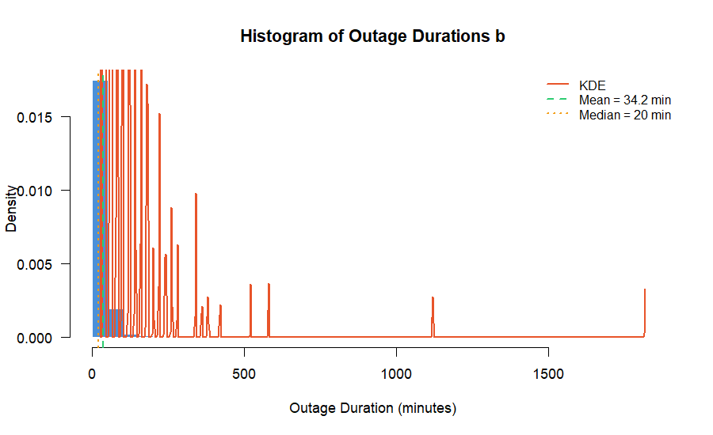
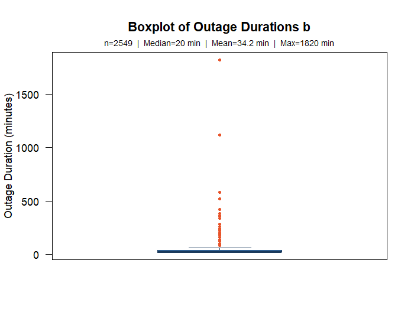
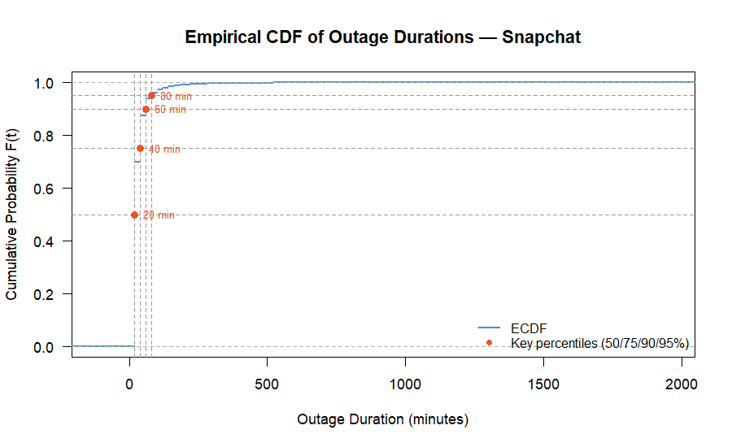
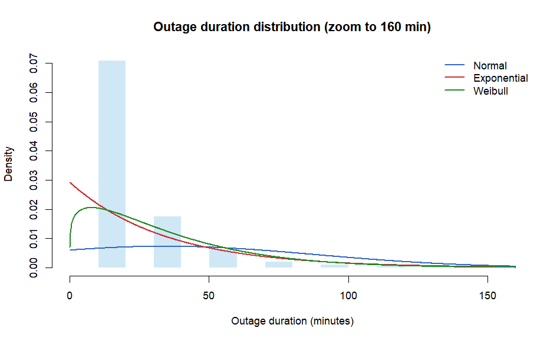
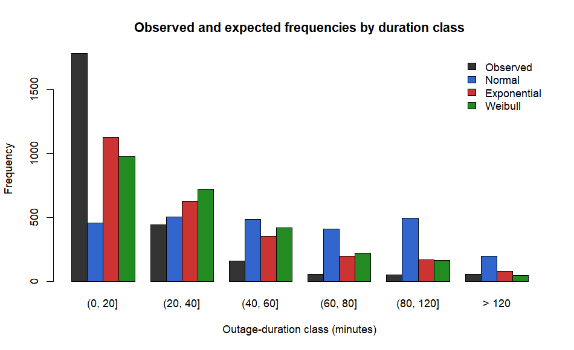
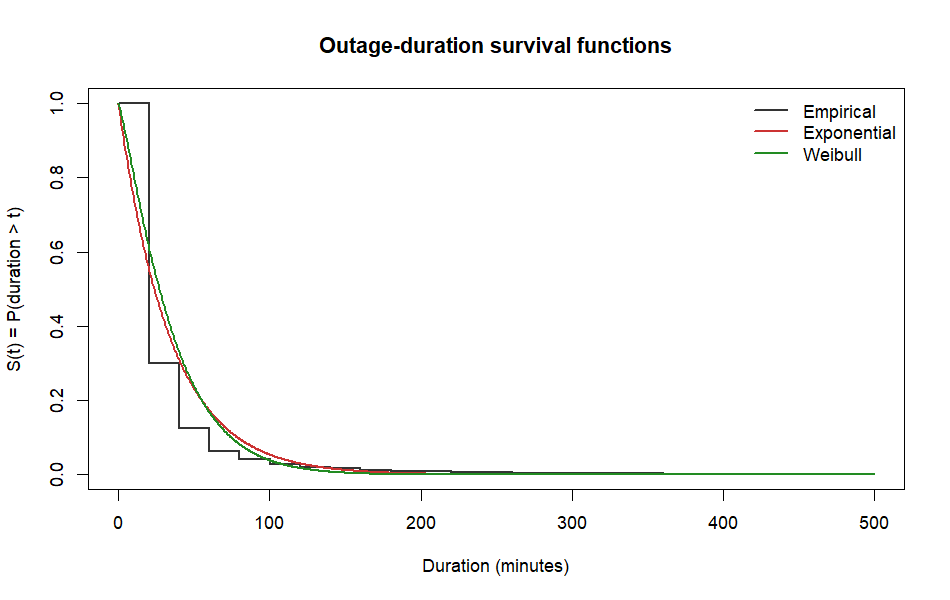
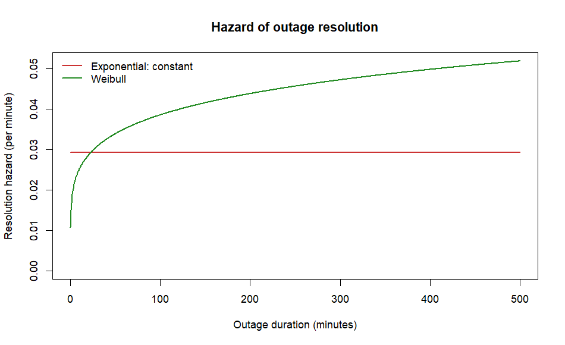

# Probabilistic Reliability Modeling of Web Services

A probability and statistics project that models how long Snapchat outages last, using 2,549 user-reported outage events from the Cloud Uptime Archive. It fits standard failure-time distributions, tests how well they fit, and interprets the results with survival and hazard functions.

## Project overview

**Research question:** How are observed Snapchat outage durations distributed, and what do distribution and reliability concepts say about outage recovery?

Outage duration is computed as `end_time - start_time` and expressed in minutes. The analysis covers:

- **Descriptive statistics:** histogram, boxplot, ECDF, skewness, and kurtosis
- **Probability distributions:** Normal, Exponential, and Weibull models of duration
- **Chi-square goodness-of-fit:** formal test of each fitted model
- **Reliability analysis:** survival and resolution-hazard functions, plus series/parallel system concepts

This is an outage-duration study, not an availability or MTBF study: the dataset has no complete uptime or inter-failure information. The raw data file is preserved unchanged.

## Dataset

`data/raw/Snapchat_user_reported.csv` has 2,549 rows with columns `start_time`, `end_time`, `status`, and `service` (all Snapchat), covering about 557 days. There were no missing values, duplicates, or invalid intervals, so no observation was removed. The cleaned file is `data/processed/Snapchat_cleaned.csv`.

## Key findings

### 1. Outage durations are short and heavily right-skewed

| Statistic | Value |
|---|---:|
| Median | 20 min |
| Mean | 34.23 min |
| Maximum | 1,820 min |
| Skewness | 18.85 |

Most outages last only 20 minutes, while a few very long ones pull the mean upward.







### 2. Distribution fitting

| Distribution | Parameters |
|---|---|
| Normal | mean = 34.23 min; SD = 54.29 min |
| Exponential | rate = 0.0292 per min |
| Weibull | shape = 1.184; scale = 36.91 min |

The Normal model is a poor choice for positive, skewed data because it assigns probability to negative durations.



### 3. Chi-square goodness-of-fit

All three models are rejected at the 5% level, so none is claimed to be the exact distribution.

| Model | Chi-square | df | p-value | Decision |
|---|---:|---:|---:|---|
| Normal (positive-duration conditional) | 4867.35 | 3 | < 0.001 | Reject H0 |
| Exponential | 731.79 | 4 | < 0.001 | Reject H0 |
| Weibull | 1137.60 | 3 | < 0.001 | Reject H0 |



### 4. Survival and hazard

`S(t) = P(D > t)` is the probability that an outage is still unresolved after `t` minutes. The Weibull shape of 1.184 (> 1) means the resolution hazard rises over time: among outages still unresolved, the instantaneous rate of resolution increases. This does not mean recovery becomes harder.





## Limitations

Durations come in 20-minute increments, producing many tied values and a spike at 20 minutes. The continuous models are therefore approximations, which is consistent with the chi-square rejections. Series/parallel formulas are discussed conceptually only, since there are no component-level records.

## Repository structure

```
data/
  raw/          original dataset (unchanged)
  processed/    cleaned dataset
scripts/        R analysis scripts (run in order)
results/
  plots/        figures
  tables/       summary tables (CSV)
report/         final written report
```

## How to run

Requires R. From the repository root, run in order:

```powershell
Rscript scripts\01_inspect_data.R
Rscript scripts\02_clean_and_explore.R
Rscript scripts\03_distribution_fitting.R
Rscript scripts\04_reliability_analysis.R
```

Plots are written to `results/plots/` and tables to `results/tables/`. The full write-up is in [report/final_report.md](report/final_report.md).
